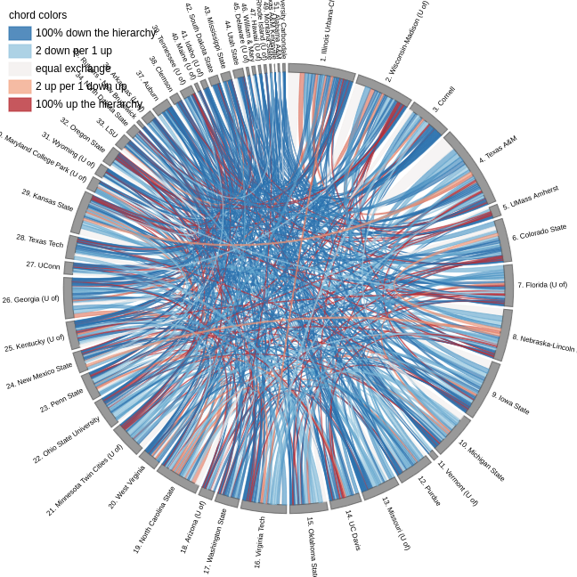

```{r setup, include=FALSE}
knitr::opts_chunk$set(echo = TRUE)
knitr::opts_knit$set(root.dir = './')
source("resources/preamble.R")
library(tidygraph)
library(ggraph)
```

## Dad Joke

Can you believe my wife told me to quit acting like a flamingo?

<p class='fragment'>
I had to put my foot down.
</p>

## Housekeeping

- Self Assessment Reflection Feedback is in
- Posting homework questions on Discord:

<div class='fragment'>
<code><pre>

```r

G |>
  activate(nodes) |>
  filter(age 25)
```

</pre>
</code>
</div>

<!--
## Housekeeping
- How did the AI assignment go?
  - What was it good at?
  - What was it bad at?
- How do you think AI will be incorporated into teaching in the future?


## Collective Norms Discussion

- I think our in-person conversations could be better
- Too many tech distractions
- Coming prepared
- How to have more natural conversations?
-->


## Concept Review

- What is centrality?
- What is the difference between centrality and centralization?

## Flash presentations

- Choose one centrality measure
- 4 minutes of prep
- 1-2 minutes of presentation
- What is it? How is it calculated? What does it tell us about power/influence?
- What are its limitations?

<!--
## Concept Review

- What is betweenness centrality?
- What is closeness centrality?
- What is eigenvector centrality?
-->

## Concept Review

- What aspects of power/influence do centrality measures miss?
- What can centralization tell us about a network?
- What does density tell us about a network?
- What is hierarchy?

## Practical Review

What is the degree/closeness/betweenness centrality of node A? What is the density of the network?

```{r echo=FALSE}
#set.seed(123)
G <- play_gnp(6, 0.6, directed=F) |> as_tbl_graph() |>
  mutate(name = LETTERS[1:nrow(.N())])


G |>
  # Get first N letters of alphabet
  ggraph(layout = 'stress') +
  geom_edge_fan() +
  #geom_node_point(aes(size = centrality_degree())) +
  geom_node_label(aes(label = name), size = 8) +
  theme_graph()
```

## Practical Review

What is the degree/closeness/betweenness centrality of node A?

```{r}
G |>
  mutate(degree = centrality_degree(),
         closeness = centrality_closeness(),
         betweenness = centrality_betweenness()) |>
  filter(name == "A")

```

## Tech Break

## Discussion Questions {.smaller}

- In real networks different people are at different levels and I'm curious how that would be graphed. For example a manager or boss, even if they have a lower degree or centrality, still is at a higher level. How is that represented in a network graph?
- Can someone who has high centrality within a network end up having little influence over those people within that network?
- The same method that "caught" Revere would flag an activist or a criminal just the same so should police be allowed to use high centrality in metadata as a reason to investigate someone?

## Discussion Questions

-  How can we know which type of centrality is most useful for a specific situation? How do researchers actually decide which measure to use when analyzing a real social network? 
- How can researchers tell if a pattern in network data is actually meaningful or just coincidence? 
- I'd like to understand the characteristics that brokers, or controllers of relationships have? And how do they get 'picked' for this role?
- What do you think has the biggest influence on each other, groups on individuals, or individuals on groups?

## R Review


## Guess the Network

For each network:

::: {.nonincremental}
- What do the **nodes** represent?
- What do the **edges** represent?
- Which nodes seem most **central** or **powerful**? Why?
:::

---

## Mystery Network 1

{height=550}

## Mystery Network 1: Revealed {.smaller}

::: {.columns}
::: {.column width="60%"}
{height=430}
:::
::: {.column width="40%"}
**U.S. House of Representatives, 1949–2011**

- **Nodes:** Members of Congress
- **Edges:** Voting agreement above a threshold
- Colors: Blue = Democrat, Red = Republican
- What structural change do you see over time?
- The nodes *between* clusters have high **betweenness** — what happens as they disappear?

*Source: [Andris et al., 2015](https://journals.plos.org/plosone/article?id=10.1371/journal.pone.0123507)*
:::
:::

---

## Mystery Network 2

{height=550}

## Mystery Network 2: Revealed {.smaller}

::: {.columns}
::: {.column width="55%"}
{height=430}
:::
::: {.column width="45%"}
**Characters in *The Force Awakens***

- **Nodes:** Characters; size = degree centrality
- **Edges:** Scene co-occurrences; width = frequency
- Highest **degree**: Poe (16)
- Highest **betweenness**: Kylo Ren (35.5)
- Luke appears isolated — why might that matter for power?

*Source: [Gabasova, 2016](https://evelinag.com/blog/2016/01-25-social-network-force-awakens/)*
:::
:::

---

## Mystery Network 3

{height=550}


## Mystery Network 3: Revealed {.smaller}


::: {.columns}
::: {.column width="55%"}
{height=550}
:::
::: {.column width="45%"}

**U.S. Faculty Hiring Network**

- **Nodes:** Universities
- **Edges:** A hire — directed from PhD-granting institution to hiring institution
- **Red edges:** Prestige gain (hired somewhere more prestigious); **Blue:** prestige loss
- 80% of all US-trained faculty came from just 20.4% of universities
- What centrality measure best captures "prestige" here? (Eigenvector / PageRank)

*Source: [Wapman et al., 2022, *Nature*](https://www.nature.com/articles/s41586-022-05222-x)*
:::
:::
